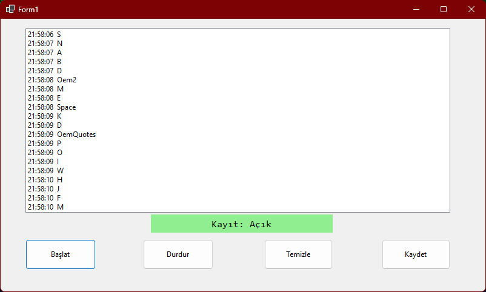
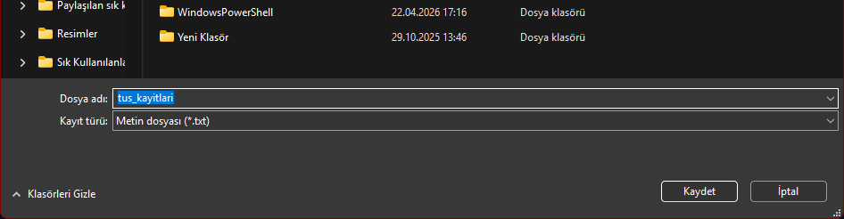
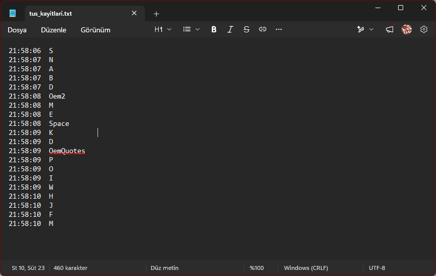

# YMH219 - Key Event Logger

Windows Forms ile yazılmış, eğitim amaçlı bir tuş kayıt uygulamasıdır. Uygulama yalnızca kendi penceresi aktifken basılan tuşları kaydeder. Global klavye hook'u, arka plan çalışması ya da başka uygulamalardan veri toplama yoktur.

## Kullanılan Teknolojiler
- C# / .NET 10.0
- Windows Forms
- Visual Studio 2026

## Kurulum ve Çalıştırma
1. Repoyu klonlayın:
   `git clone https://github.com/esmanuryilmaz3012/YMH219-KeyEventLogger.git`
2. Klasöre girin ve `KeyEventLogger.slnx` dosyasını Visual Studio ile açın.
3. `Ctrl+Shift+B` ile derleyin, `F5` ile çalıştırın.

## Özellikler
- Başlat / Durdur ile kaydı açıp kapatma
- Basılan tuşun adını ve saatini listede gösterme (Shift, Ctrl, ok tuşları dahil)
- Kayıt durumunu renkli etiketle gösterme (yeşil: açık, kırmızı: kapalı)
- Temizle ile listeyi silme
- Kaydet ile kayıtları `.txt` dosyasına yazma. Kaydetme sırasında kayıt otomatik durdurulur.
- Dosya yazma hatalarını kullanıcıya mesaj kutusuyla bildirme

## Ekran Görüntüleri

## Bilinen Sınırlamalar
- Yalnızca uygulama penceresi aktifken çalışır. Bu bilerek böyle yapılmıştır.
- Kayıtlar otomatik dosyaya yazılmaz, kullanıcının Kaydet'e basması gerekir.
- Uygulama kapatılınca listedeki kayıtlar kaybolur.
- Butonlar odaktayken Boşluk veya Enter tuşu buton tıklamasını da tetikleyebilir.

---
**Öğrenci:** Esmanur Yılmaz - 250541033
